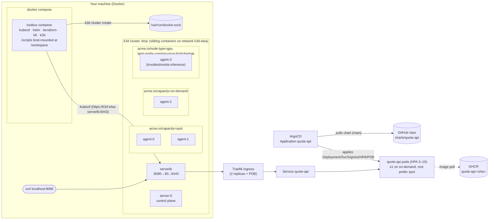
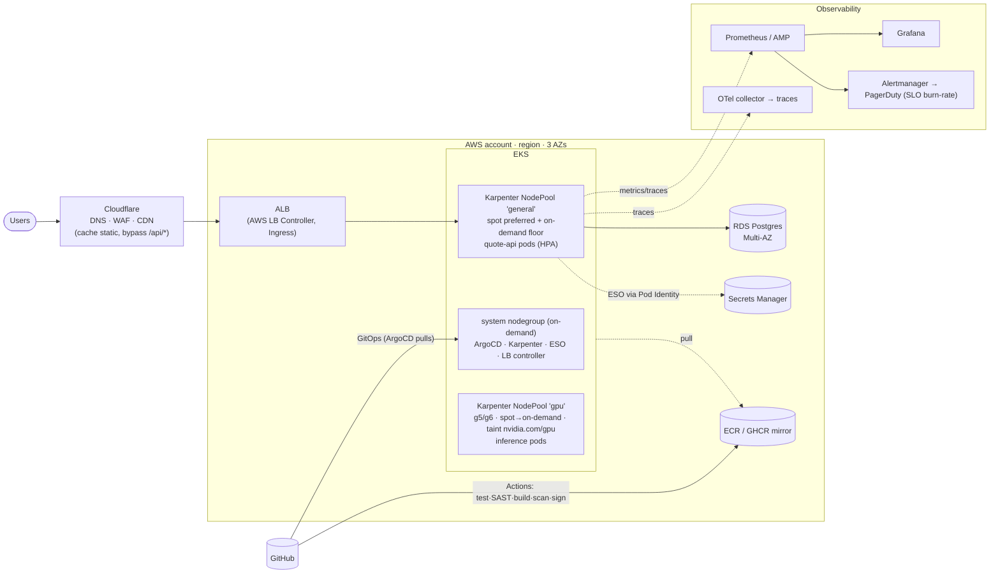

# ELSA DevOps take-home — quote-api on a multi-nodepool k3d cluster

[](https://github.com/rummannaqvi/elsa-devops-assignment/actions/workflows/ci.yml)

| | |
|---|---|
| Image | `ghcr.io/rummannaqvi/quote-api:<git-sha>` (multi-arch, cosign-signed) — <https://github.com/rummannaqvi/elsa-devops-assignment/pkgs/container/quote-api> |
| Scope | CORE (Parts 1–3 + docs) · **Part 4 (CI/CD migration)** as the hands-on track · Part 7 |
| Docs | [TROUBLESHOOTING.md](TROUBLESHOOTING.md) · [MIGRATION-NOTES.md](MIGRATION-NOTES.md) · [OPS-ANSWERS.md](OPS-ANSWERS.md) · [AI-USAGE.md](AI-USAGE.md) |

## Quick start

Requirements: Docker (Desktop or Engine with Compose v2), ~4 CPU / 6 GB free for Docker, port 8080 free, bash.

```bash
git clone https://github.com/rummannaqvi/elsa-devops-assignment.git && cd elsa-devops-assignment
docker compose up -d          # builds the toolbox, creates a 1-server + 4-agent k3d cluster, runs prepare.sh
./scripts/run-all.sh          # ArgoCD + app, spot-reclaim drill, troubleshooting fix + verify.sh
curl http://localhost:8080/api/quote
```

`run-all.sh` waits for the cluster bootstrap if it's still running (follow it with `docker compose logs -f toolbox`).
Every script can be run alone, from the host (`./scripts/25-reclaim-drill.sh`) or inside the toolbox
(`docker compose exec toolbox bash` → `scripts/25-reclaim-drill.sh`). Teardown: `./scripts/99-teardown.sh && docker compose down`.

This exact sequence runs on a clean GitHub runner after every merge (`e2e` job), so it is tested, not hoped.

## Architecture



**CI/CD flow (Part 4):** PR → `quality` (unit tests, Semgrep hard gate + gate self-test) → `build` (Trivy gate) →
on `main`: push `:<sha>` multi-arch to GHCR, cosign-sign → `gitops-bump` commits the SHA into
`charts/quote-api/values.yaml` → ArgoCD syncs → `e2e` runs the Quick start on a fresh runner.

### Bonus: the same service on AWS



## Script reference

| Script | What it does | When |
|---|---|---|
| `scripts/00-bootstrap.sh` | Creates/starts k3d (1 server + 4 agents, `:8080` → ingress), joins the toolbox to the cluster network, writes kubeconfig, runs `troubleshoot/prepare.sh`, scales Traefik to 2 replicas + PDB. Lock-protected, idempotent. | Automatically on `docker compose up -d` |
| `scripts/20-deploy.sh` | Installs ArgoCD (pinned), applies `deploy/argocd/quote-api.yaml`, waits for Synced/Healthy, asserts placement policy, curls through the ingress. | Part 2 |
| `scripts/25-reclaim-drill.sh` | Drains a spot node hosting a replica while a 5 req/s curl loop hits the ingress; shows rescheduling + placement; uncordons; fails if availability < 99%. | Part 2 |
| `scripts/30-troubleshoot.sh` | Applies `broken-app.yaml`, prints the symptoms, applies `fixed-app.yaml`, runs the provided `verify.sh` (expects `PASS`). | Part 3 |
| `scripts/run-all.sh` | 00 → 20 → 25 → 30. | Reviewer entry point |
| `scripts/99-teardown.sh` | Deletes the k3d cluster (then `docker compose down`). | Cleanup |
| `scripts/lib.sh` | Shared helpers; makes every script re-exec itself inside the toolbox when run from the host. | — |

## Design decisions & trade-offs

- **Track choice: Part 4.** It closes the loop on the CORE: the same pipeline builds/pushes the GHCR image ArgoCD
  deploys, and its `e2e` job continuously proves the Golden Rule. One track done well over three rushed.
- **k3d driven from the toolbox** via the Docker socket: `docker compose up -d` is the only command that creates the
  cluster. Nodes are sibling containers; the toolbox joins the `k3d-elsa` network and talks to `k3d-elsa-serverlb:6443`
  (added to the API cert SANs). Trade-off: the toolbox holds a root-equivalent socket — fine for a local harness.
- **Placement** (the interesting bit): required node affinity to `{spot, on-demand}` (never GPU/control-plane) +
  preferred spot (weight 100) + a topology spread over `acme.io/capacity` with **`maxSkew: 2`, `DoNotSchedule`**.
  With 3 replicas the third pod can't go to spot (3–0 skew > 2), so **≥1 replica is guaranteed on on-demand**, while
  2 of 3 can sit on spot. `nodeTaintsPolicy: Honor` drops cordoned nodes from the skew math, so a drained node (or
  the on-demand node itself disappearing) never deadlocks rescheduling. Hostname spread is `ScheduleAnyway` (soft).
  `matchLabelKeys: [pod-template-hash]` keeps the guarantee per ReplicaSet during rollouts.
  Trade-offs: at scale the skew bound means spot ≤ on-demand + 2 (e.g. 6/4 at 10 replicas) — more on-demand than
  pure cost-optimisation would choose; the alternative (separate on-demand "floor" Deployment) is more precise but
  splits the HPA. The scheduler doesn't re-balance after recovery; I'd add the descheduler in production.
- **GitOps all the way**: no `helm install` of the app; the image tag lives in Git and CI bumps it. HPA owns
  `replicas` (not set in the Deployment) so ArgoCD and the HPA don't fight.
- **Drill realism**: k3s ships one Traefik replica; draining its node takes down the ingress and the drill would
  measure Traefik, not the app. Bootstrap sets 2 replicas + PDB (+ prefers on-demand). App pods use a `preStop`
  sleep so endpoints drain before shutdown; PDB `maxUnavailable: 1`.
- **App**: Python stdlib HTTP server + `prometheus_client` (one dependency), multi-stage on Alpine, UID 10001,
  read-only rootfs, all capabilities dropped, pip removed from the runtime image. The 100 ms "work" uses
  `thread_time()` so it is real CPU, not a sleep.
- **Cut, on purpose**: Parts 5 and 6 (one track done properly instead); ArgoCD UI/ingress (not needed to verify);
  in-cluster signature verification (Kyverno) — noted as the next step after signing; tool checksums in the toolbox
  build (pinned versions over HTTPS only).

## Troubleshooting notes (reviewer machine)

- **Port 8080 already in use** → `HOST_HTTP_PORT=8081 docker compose up -d` (then curl `:8081`). If the cluster was
  already created on 8080, run `./scripts/99-teardown.sh` first.
- **Not enough resources / pods Pending / bootstrap timeout** → give Docker Desktop ≥ 4 CPU and 6 GB RAM.
  Re-run `./scripts/00-bootstrap.sh` (idempotent); check `docker compose logs toolbox`.
- **Every pod `Pending` with `untolerated taint {node.kubernetes.io/disk-pressure}`** → the host disk is ≥ ~85–90%
  full (k3d nodes share the host's disk, and kubelet stops scheduling below its free-space threshold). Free space, e.g.
  `docker builder prune -af && docker image prune -af`; the taint clears by itself within a minute. (Hit this on my
  own machine at 97% full.)
- **Apple Silicon / arm64** → supported: the app image is published for amd64 + arm64 and the toolbox is built
  locally for your arch.
- **Windows** → run the scripts from Git Bash or WSL2; `lib.sh` sets `MSYS_NO_PATHCONV` so paths aren't mangled,
  and `.gitattributes` forces LF line endings. If a `git clone` still produced CRLF scripts, re-clone with
  `git -c core.autocrlf=false clone …`.
- **`docker compose down` complains the network is in use / cluster still running** → the k3d nodes live outside
  compose by design; run `./scripts/99-teardown.sh` first.
- **ArgoCD can't fetch the chart** → the cluster needs outbound HTTPS to github.com and ghcr.io.

## Handoff issues found in the provided files

Treated like an incident: diagnosed, worked around without breaking the rules, documented.

1. `ci/legacy.gitlab-ci.yml` hard-codes an AWS key pair (doc example values). Committing it verbatim would put
   credential-shaped strings in a public repo ("no secrets of any kind"), so the committed copy is **redacted**.
   Details in MIGRATION-NOTES.
2. `broken-app.yaml` selects GPU nodes by `node-type`, but `prepare.sh` labels `acme.io/node-type` — fixed in the workload.
3. `prepare.sh` taints `nvidia.com/gpu=true:NoSchedule`; real EKS GPU pools usually use the value-less
   `nvidia.com/gpu:NoSchedule` — the fix uses an `Exists` toleration that matches both.
4. `prepare.sh` says "run ONCE"; bootstrap re-runs it on restart — verified it's idempotent, left unmodified.
5. `verify.sh` uses the deprecated core/v1 Endpoints API (1.33+); pinned k3s v1.31 and left it unmodified.
6. k3s' single Traefik replica would make the reclaim drill fail for the wrong reason — made the ingress HA.
